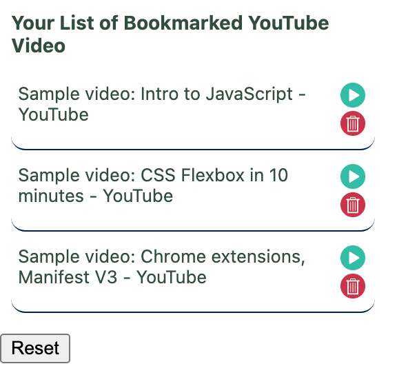
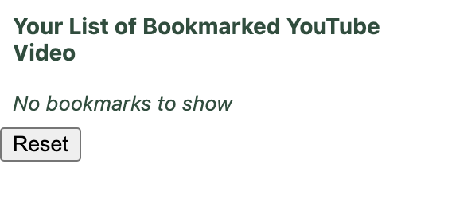
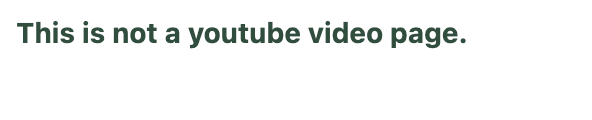
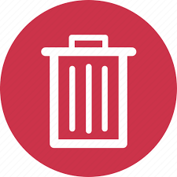

<div align="center">


# YouTube Bookmarked List

**A Chrome extension that saves YouTube videos to a bookmark list with one click from the player**


</div>

## About

YouTube Bookmarked List adds a bookmark button to the YouTube video player. Click it while watching and the video is saved to your personal list. Open the extension's popup to see every saved video, jump back to one with **Play**, remove it with **Delete**, or clear the whole list with **Reset**.

Bookmarks are stored with `chrome.storage.sync`, so when you're signed in to Chrome your list follows you to your other computers. Nothing is sent to any server.

## Screenshots

<p align="center"><br/><sub>The popup on a YouTube page: saved videos with Play and Delete, plus Reset to clear the list (sample data).</sub></p>

<table>
<tr>
<td align="center" width="50%"><br/><sub>Before anything is saved.</sub></td>
<td align="center" width="50%"><br/><sub>Opened on a page that isn't YouTube.</sub></td>
</tr>
</table>

## Features

-  **One-click save:** a bookmark button sits in the player's left controls on every `youtube.com/watch` page.
- **No duplicates:** each video is saved once, keyed by its video ID.
-  **Play:** opens the saved video in the current tab.
-  **Delete:** removes a single video from the list.
- **Reset:** clears every bookmark at once.
- **Synced storage:** uses `chrome.storage.sync`, so the list is shared across your signed-in Chrome browsers.

## Installation

The extension isn't on the Chrome Web Store, so load it unpacked:

1. Clone the repository:
   ```bash
   git clone https://github.com/achu1998/youTubeVideo-List-Extension.git
   ```
2. Open `chrome://extensions` in Chrome (or `brave://extensions`, `edge://extensions`).
3. Turn on **Developer mode** (top right).
4. Click **Load unpacked** and pick the `youTubeVideo-List-Extension` folder.
5. Pin **YT Bookmarks List** from the extensions menu so it's one click away.

## Usage

1. Open any YouTube video.
2. Click the bookmark icon in the player controls to save it.
3. Click the extension icon in the toolbar to see your list.
4. Use **Play** to open a video, **Delete** to remove one, or **Reset** to clear everything.

## How it works

| File | Role |
|---|---|
| [`manifest.json`](manifest.json) | Manifest V3 config: `storage`, `tabs` and `webNavigation` permissions, limited to `youtube.com` |
| [`background.js`](background.js) | Service worker. When a `youtube.com/watch` tab updates, it sends the video ID, URL and title to the page |
| [`contentScript.js`](contentScript.js) | Runs on YouTube. Adds the bookmark button to the player, saves bookmarks, and handles Play and Delete |
| [`popup.html`](popup.html) · [`popup.js`](popup.js) · [`popup.css`](popup.css) | The toolbar popup that lists, plays and deletes bookmarks |
| [`utils.js`](utils.js) | Helper that returns the active tab |

```
YouTube tab ──tab updated──▶ background.js ──"NEW" message──▶ contentScript.js ──▶ chrome.storage.sync
                                                                     ▲
popup.js ──"PLAY" / "DELETE" messages────────────────────────────────┘
```

## Tech stack

`JavaScript` · `Chrome Extensions API (Manifest V3)` · `chrome.storage.sync` · `HTML` · `CSS`

------------------------------------------------------------------------

Developed by Ashween R
